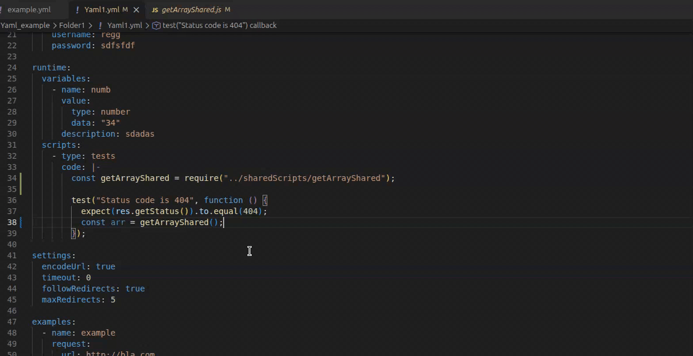
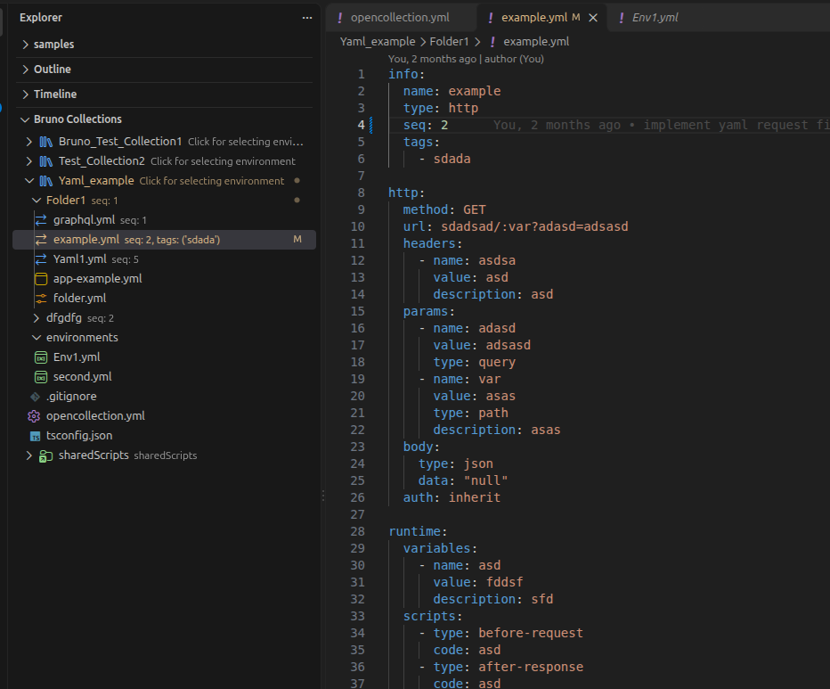
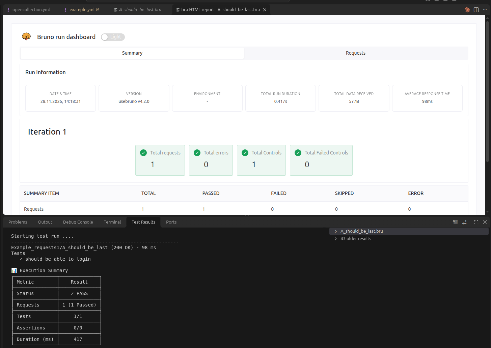

## About the project

This extension lets you work with [Bruno](https://docs.usebruno.com/) collections like with code, with a strong focus on intellisense. Both collection formats are supported: `bru` files and the `yaml` format (`opencollection.yml`).

**Disclaimer: All Bruno names, brands, trademarks, service marks and logos are the property of Bruno. This is not the official Bruno extension for VS Code but an unofficial one. The official extension can be found [here](https://marketplace.visualstudio.com/items?itemName=bruno-api-client.bruno).**

## Main Features

- **Collection explorer** for creating, renaming, duplicating, moving (via drag and drop) and deleting requests and folders within your collections. Folders with shared scripts (`additionalContextRoots`) are shown next to the collections.
- **Test explorer integration** for running requests, folders or whole collections via the [Bruno CLI](https://www.npmjs.com/package/@usebruno/cli), including HTML test reports.
- **Language features** for `.bru` files and `yaml` collection files, e.g. completions, hovers, diagnostics and syntax highlighting, as well as Javascript intellisense within code blocks (scripts and tests). A formatter for code blocks is included as well.
- **Review-friendly diffs**: Adding, moving or deleting a request changes as few other files as possible, and file names can show the execution order. See [Review-friendly diffs](#review-friendly-diffs) for the recommended setup.



The collection explorer next to a request in the `yaml` format:



A finished test run with the HTML report and the output of the Bruno CLI:



## Using the extension

### Getting started

For running tests via the extension, install the [Bruno CLI](https://www.npmjs.com/package/@usebruno/cli) (requires `Node.js` and `npm`), either globally or as a dev dependency of your collection. A locally installed CLI is preferred over a global one. Alternatively, you can configure the path to the CLI via the setting `bru-as-code.cliPath`.

### Review-friendly diffs

Bruno stores the execution order as a sequence (`seq`) in every request and folder. If the sequences are consecutive (1, 2, 3, ...), inserting one request also changes the files of the requests after it. With gaps between the sequences, there is usually a free one for the inserted request, so that no other file has to change.

For example, this is what a reviewer sees after `refresh-token` was inserted after `login`:

Consecutive sequences, 4 changed files:

```diff
  login.bru            seq: 1
+ refresh-token.bru    seq: 2
- get-user.bru         seq: 2
+ get-user.bru         seq: 3
- update-user.bru      seq: 3
+ update-user.bru      seq: 4
- delete-user.bru      seq: 4
+ delete-user.bru      seq: 5
```

Sequences with gaps, 1 changed file:

```diff
  login.bru            seq: 10
+ refresh-token.bru    seq: 15
  get-user.bru         seq: 20
  update-user.bru      seq: 30
  delete-user.bru      seq: 40
```

The collection explorer uses such gaps automatically and keeps the sequences of other items whenever possible. It does not create gaps in existing collections on its own, though. To set them up:

1. Add the settings to the `.vscode/settings.json` of your repository, so that they apply to your whole team:

    ```json
    {
        "bru-as-code.sequenceStep": 10,
        "bru-as-code.prefixNamesWithSequence": true
    }
    ```

    The second setting is optional. It prefixes the names of requests and folders with their sequence (e.g. `00010_login.bru`), so that they are listed in execution order in the file explorer and in diffs. The collection explorer keeps the prefixes in sync.

2. Select _Normalize sequences_ in the context menu of a collection in the collection explorer and choose the same step (`10`). If the prefixes are enabled, this also renames the files and folders.
3. Commit the result separately, since this changes many files once.

When items are renamed, the paths of `bru.runRequest` calls in the collection are updated as well (only string literals). Paths used elsewhere (e.g. in CI pipelines that run single requests or folders) need to be adjusted manually. The prefixes can be removed again via _Remove sequence prefixes_ in the context menu of a collection or folder (disable the setting first).

### Improving intellisense

- Add a `tsconfig.json` (with `"allowJs": true`) to the root folder of every collection (and of every `additionalContextRoots` folder containing Javascript files). The extension offers to create a default one.
    - Without it, your compiler options (e.g. `strict`, `checkJs`, `lib`) do not apply to your scripts, and collections in the same folder may share type definitions (e.g. of `chai`), so that the types of the first opened collection are used for all of them.
    - See the [tsconfig reference](https://www.typescriptlang.org/tsconfig/) for the available options, e.g. for enabling type checking of your Javascript code.
- Install type definitions as dev dependencies for the inbuilt Bruno libraries that you use, most importantly [Mocha](https://www.npmjs.com/package/@types/mocha) (for `test('description', function() {...})`) and [Chai](https://www.npmjs.com/package/@types/chai) (for `expect` validations). The same applies to other libraries, e.g. `axios` or `moment`.
- Add types via [JSDoc](https://www.typescriptlang.org/docs/handbook/jsdoc-supported-types.html) to your code blocks and Javascript files.
- For syntax highlighting of SPARQL request bodies, install an extension that supports SPARQL, e.g. `stardog-union.stardog-rdf-grammars`.

### Typescript 7 language server

The Javascript intellisense in code blocks (scripts and tests) is provided via a Typescript server plugin. The Typescript 7 (native) language server does not support such plugins yet, so this intellisense is not available while it is used (`js/ts.experimental.useTsgo`). For now, use the default language server to get Javascript intellisense in Bruno files. All other features (e.g. completions, hovers, diagnostics and syntax highlighting for the Bru and Yaml content) keep working.

### Using alongside other Bruno extensions

Other extensions that also handle Bruno collections (e.g. the official [Bruno](https://marketplace.visualstudio.com/items?itemName=bruno-api-client.bruno) extension) may provide overlapping or conflicting features, like duplicate completions and diagnostics or competing syntax highlighting. If you notice issues like these, we recommend disabling the other extension, at least for the affected workspaces (_Disable (Workspace)_ in the Extensions view).

## Contributing

For contributing, check out the GitHub repository https://github.com/daniel-b92/bruno-vs-code-extension.
See [CONTRIBUTING.md](https://github.com/daniel-b92/bruno-vs-code-extension/blob/main/CONTRIBUTING.md) for how to set up the project and which checks run for pull requests.
