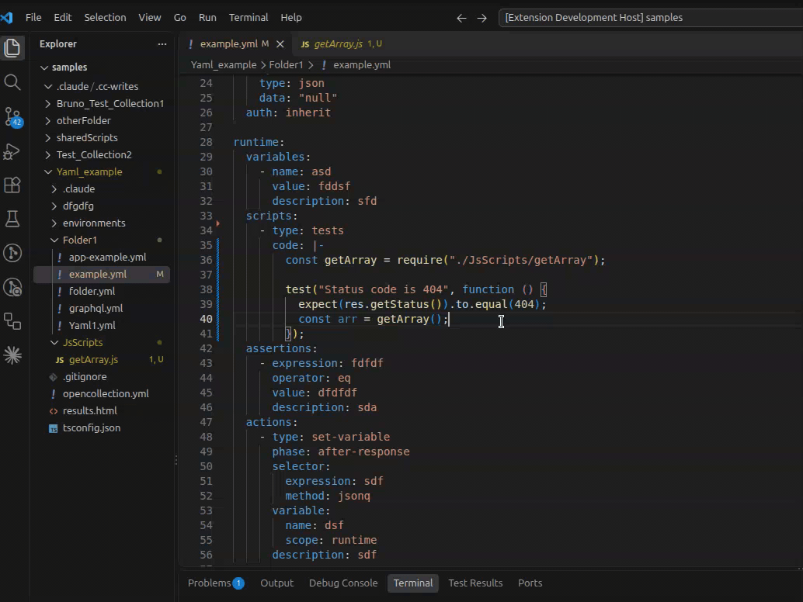

## About the project

This extension lets you work with [Bruno](https://docs.usebruno.com/) collections like with code, with a strong focus on intellisense. Both collection formats are supported: `bru` files and the `yaml` format (`opencollection.yml`).

**Disclaimer: All Bruno names, brands, trademarks, service marks and logos are the property of Bruno. This is not the official Bruno extension for VS Code but an unofficial one. The official extension can be found [here](https://marketplace.visualstudio.com/items?itemName=bruno-api-client.bruno).**

## Main Features

- **Collection explorer** for creating, renaming, duplicating, moving (via drag and drop) and deleting requests and folders within your collections.
- **Test explorer integration** for running requests, folders or whole collections via the [Bruno CLI](https://www.npmjs.com/package/@usebruno/cli), including HTML test reports.
- **Language features** for `.bru` files and `yaml` collection files, e.g. completions, hovers, diagnostics and syntax highlighting, as well as Javascript intellisense within code blocks (scripts and tests). A formatter for code blocks is included as well.



## Using the extension

### Getting started

For running tests via the extension, install the [Bruno CLI](https://www.npmjs.com/package/@usebruno/cli) (requires `Node.js` and `npm`), either globally or as a dev dependency of your collection. A locally installed CLI is preferred over a global one. Alternatively, you can configure the path to the CLI via the setting `bru-as-code.cliPath`.

### Improving intellisense

- Add a `tsconfig.json` (with `"allowJs": true`) to the root folder of every collection (and of every `additionalContextRoots` folder containing Javascript files). The extension offers to create a default one.
    - Without it, your compiler options (e.g. `strict`, `checkJs`, `lib`) do not apply to your scripts, and collections in the same folder may share type definitions (e.g. of `chai`), so that the types of the first opened collection are used for all of them.
    - See the [tsconfig reference](https://www.typescriptlang.org/tsconfig/) for the available options, e.g. for enabling type checking of your Javascript code.
- Install type definitions as dev dependencies for the inbuilt Bruno libraries that you use, most importantly [Mocha](https://www.npmjs.com/package/@types/mocha) (for `test('description', function() {...})`) and [Chai](https://www.npmjs.com/package/@types/chai) (for `expect` validations). The same applies to other libraries, e.g. `axios` or `moment`.
- Add types via [JSDoc](https://www.typescriptlang.org/docs/handbook/jsdoc-supported-types.html) to your code blocks and Javascript files.
- For syntax highlighting of SPARQL request bodies, install an extension that supports SPARQL, e.g. `stardog-union.stardog-rdf-grammars`.

### Using alongside other Bruno extensions

Other extensions that also handle Bruno collections (e.g. the official [Bruno](https://marketplace.visualstudio.com/items?itemName=bruno-api-client.bruno) extension) may provide overlapping or conflicting features, like duplicate completions and diagnostics or competing syntax highlighting. If you notice issues like these, we recommend disabling the other extension, at least for the affected workspaces (_Disable (Workspace)_ in the Extensions view).

## Contributing

For contributing, check out the GitHub repository https://github.com/daniel-b92/bruno-vs-code-extension.
You need to have `Node.js` and `npm` installed.
Run the following command to install the dependencies of all projects:

```bash
npm install && cd client && npm install && cd ../server && npm install && cd ..
```

If you want to make changes to the Typescript language service plugin used by the extension, see its [Readme](./tsPlugin/README.md) for more infos.
